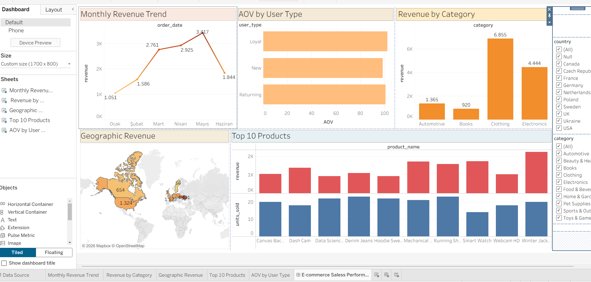

# E-commerce Sales Analysis 2024

End-to-end analysis of e-commerce orders: revenue trends, category and product performance, customer value and RFM segmentation, plus an interactive Tableau dashboard and data-driven recommendations.

Built for the **GOIT Data Analytics Hackathon (E-commerce Track)**.

**Tech stack:** Google Sheets · SQL · Python (pandas, matplotlib, seaborn) · Tableau Public



**Live dashboard:** [Tableau Public link](ADD_YOUR_LINK_HERE)

---

## Business Questions

1. How does revenue change over the year, and when does it peak?
2. Which categories and products generate the most revenue?
3. How does Average Order Value (AOV) differ by user type (New / Returning / Loyal)?
4. Which customers buy most recently, most often and with the highest spend?
5. Which campaigns, cross-sell or customer actions can be recommended?

## Dataset

Four related tables (2024):

| Table | Grain | Key columns |
|---|---|---|
| `orders` | one row per order | order_id, user_id, order_date, total_amount |
| `order_items` | one row per product in an order | order_id, product_id, quantity, price |
| `products` | one row per product | product_id, category, product_name |
| `users` | one row per user | user_id, user_type, country |

Relations: `users.user_id → orders.user_id`, `orders.order_id → order_items.order_id`, `products.product_id → order_items.product_id`.

Revenue is calculated at item level: `item_revenue = price × quantity`.

## Repository Structure

```
├── data/          # source tables (CSV)
├── googlesheet/   # lookups, calculated field and pivot tables
├── sql/           # sales analysis queries (datathon2.sql)
├── python/        # EDA and RFM analysis
│   └── outputs/   # charts and exported tables
└── tableau/       # interactive dashboard
```

## Methodology

1. **Google Sheets:** joined the tables with lookups on `order_items`, created `item_revenue`, built pivots for category, user type and month.
2. **SQL:** data quality checks (row counts, duplicates, join row inflation), then monthly revenue by category, top 10 products, AOV by user type and customer lifetime value.
3. **Python:** merged all tables with join validation, ran EDA and built an RFM model (reference date = last order date + 1 day, quintile scores, rule-based segments).
4. **Tableau:** dashboard with monthly revenue trend, revenue by category, geographic revenue, top 10 products and AOV by user type. Filters: category, country, user type, date range, product.

## Key Findings

- **Seasonality:** monthly revenue grows steadily from about 1.1K in January to a peak of about 3.4K in May, then drops to about 1.8K in June. [Confirm whether June is a complete month.]
- **Categories:** Clothing (about 6.9K) and Electronics (about 4.4K) generate the most revenue, well ahead of Automotive and Books. [Add the remaining categories.]
- **Geography:** the USA is the largest market, followed by Canada and several European countries. [Add exact figures.]
- **Top products:** [Name the top 3 products and compare revenue with units sold.]
- **AOV by user type:** [User type] has the highest AOV ([X]), while [user type] generates the highest total revenue ([X]) because of order volume.
- **RFM:** [N] customers ([X%]) are *Champions* and produce [X%] of revenue. [N] customers are *At Risk*, with an average recency of [X] days.
- **Spend vs. loyalty:** the top 10% by spend and the top 10% by frequency overlap by only [X%], so the highest spender is not always the most loyal customer.

## Recommendations

1. **Seasonal campaigns and stock planning:** build stock and ad budget ahead of the spring ramp-up (March to May) and use the weaker early-year months for promotions that lift demand.
2. **Product prioritization:** protect availability and visibility of Clothing and Electronics, which drive the largest share of revenue, and review pricing or assortment in the weakest categories.
3. **VIP and retention program:** offer Champions early access or loyalty rewards, and run a personalized reactivation offer for At Risk customers before they churn.
4. **Segment-based marketing:** use bundles and free-shipping thresholds to raise basket size for the user type with the lowest AOV, and focus acquisition on the strongest country markets.
5. **Cross-sell:** recommend complementary products at checkout, such as accessories for Electronics buyers.

## How to Run

```bash
pip install pandas matplotlib seaborn
cd python
python rfm_analysis.py
```

Outputs (charts and CSVs) are saved to `python/outputs/`. `analysis_table.csv` is the joined table used for the Tableau dashboard.

## Author

**[Your name]** · [LinkedIn](ADD_LINK_HERE)
